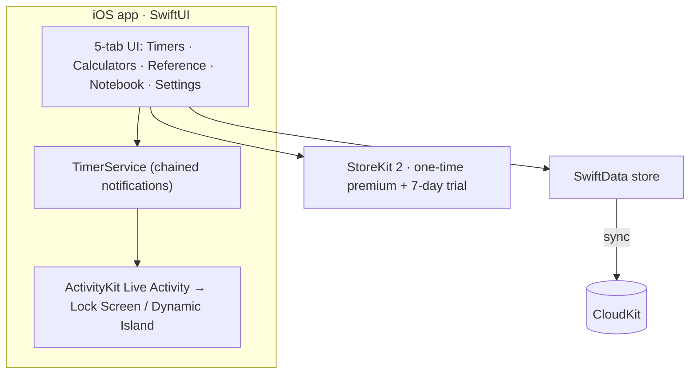
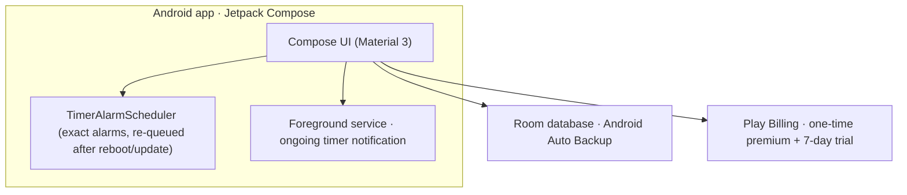
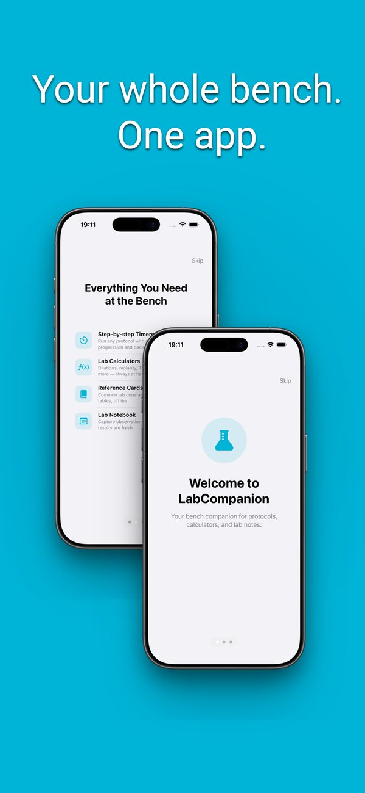
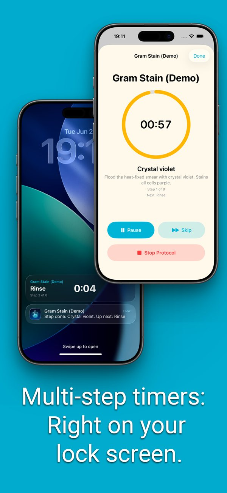
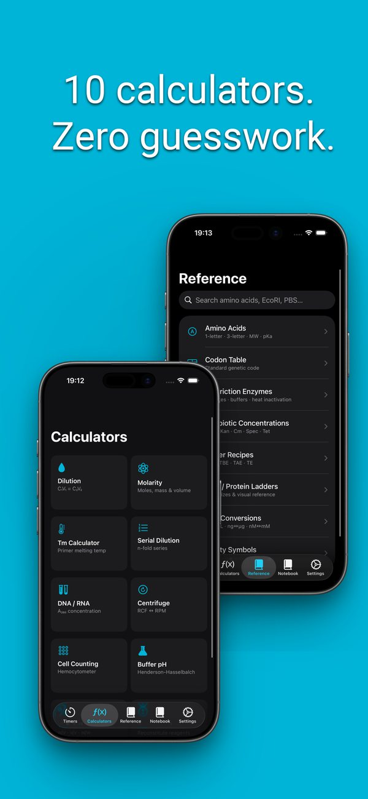

# LabCompanion 🧪

**The lab bench in your pocket.** An iOS and Android app for wet-lab scientists — calculators, protocol timers, and reference cards in one fast, offline-first, privacy-respecting app.

[App Store](https://apps.apple.com/dk/app/labcompanion-lab-calculator/id6770509131) · [Google Play](https://play.google.com/store/apps/details?id=dk.ATproductions.labcompanion)

## What it does
- **10 lab calculators** — dilution (C₁V₁=C₂V₂), molarity, serial dilution, primer Tm, centrifuge RCF↔RPM, cell counting, buffer pH, % solution, resuspension, DNA/RNA concentration — unit-aware, with European-comma support
- **Protocol timers** — multi-step, with background step alerts and **Lock Screen Live Activities**
- **8 offline reference cards** — codon & amino-acid tables, restriction enzymes, antibiotic concentrations, ladders, buffer recipes, safety symbols
- **Lab Notebook** (Premium) — photo + text notes, tags, search, PDF export, iCloud sync

## Architecture

The Android app is a native Kotlin port, not a cross-platform build:

## Engineering highlights
- **Live Activities** via ActivityKit — the running protocol counts down on the Lock Screen using `Text(timerInterval:)`, so updates are pushed only on step changes (battery-friendly).
- **Suspended-safe notifications** — all remaining step alerts are scheduled upfront with cumulative fire dates, so the phone buzzes at every step boundary even while backgrounded.
- **Resilient persistence** — SwiftData with a CloudKit → local → in-memory fallback ladder so a store failure never silently drops user data.
- **StoreKit 2** one-time non-consumable with a Keychain-backed install-date trial. No ads and no tracking SDKs.
- Accessibility-first: 44pt targets, VoiceOver labels, dark-mode colour hierarchy.

## Tech stack
| Area | Technologies |
|---|---|
| iOS app | SwiftUI, SwiftData, ActivityKit, WidgetKit (iOS 18+) |
| Android app | Kotlin, Jetpack Compose, Room, DataStore (Android 8.0+ / API 26) |
| Sync | CloudKit (iOS) · Android Auto Backup |
| Monetization | StoreKit 2 · Google Play Billing (no ads) |

## Screenshots

  
  
  

---
© 2026 Alen Trgovcevic · AT Productions (CVR 46159640). Source code is private; this repository is a public architecture overview.
