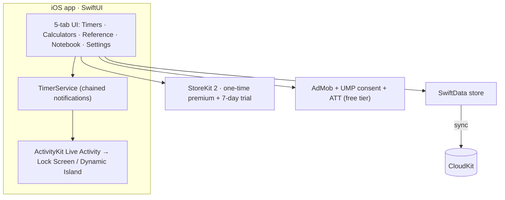

# LabCompanion 🧪

**The lab bench in your pocket.** An iOS app for wet-lab scientists — calculators, protocol timers, and reference cards in one fast, offline-first, privacy-respecting app.

## What it does
- **10 lab calculators** — dilution (C₁V₁=C₂V₂), molarity, serial dilution, primer Tm, centrifuge RCF↔RPM, cell counting, buffer pH, % solution, resuspension, DNA/RNA concentration — unit-aware, with European-comma support
- **Protocol timers** — multi-step, with background step alerts and **Lock Screen Live Activities**
- **8 offline reference cards** — codon & amino-acid tables, restriction enzymes, antibiotic concentrations, ladders, buffer recipes, safety symbols
- **Lab Notebook** (Premium) — photo + text notes, tags, search, PDF export, iCloud sync

## Architecture

## Engineering highlights
- **Live Activities** via ActivityKit — the running protocol counts down on the Lock Screen using `Text(timerInterval:)`, so updates are pushed only on step changes (battery-friendly).
- **Suspended-safe notifications** — all remaining step alerts are scheduled upfront with cumulative fire dates, so the phone buzzes at every step boundary even while backgrounded.
- **Resilient persistence** — SwiftData with a CloudKit → local → in-memory fallback ladder so a store failure never silently drops user data.
- **StoreKit 2** one-time non-consumable with a Keychain-backed install-date trial; **UMP** consent + **App Tracking Transparency** sequenced after onboarding; AdMob with Meta Audience Network fallback.
- Accessibility-first: 44pt targets, VoiceOver labels, dark-mode colour hierarchy.

## Tech stack
| Area | Technologies |
|---|---|
| App | SwiftUI, SwiftData, ActivityKit, WidgetKit (iOS 17+) |
| Sync | CloudKit |
| Monetization | StoreKit 2, AdMob, UMP, Meta Audience Network |

## Screenshots
_Add app screenshots to `docs/screenshots/`._

---
© 2026 Alen Trgovcevic · AT Productions (CVR 46159640). Source code is private; this repository is a public architecture overview.
